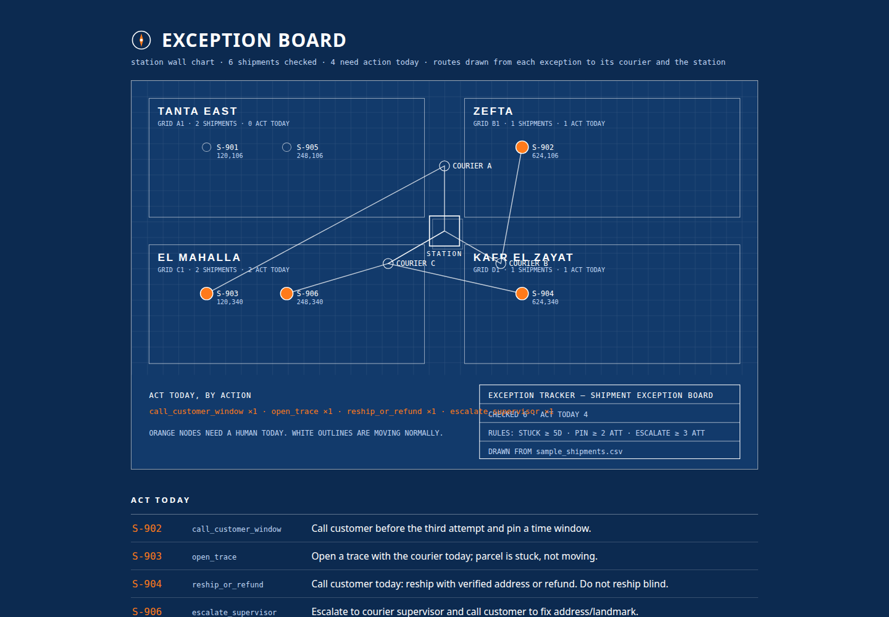

# Exception Tracker

A station does not lose money on the 90% of parcels that move normally.
It loses money on the handful that sit stuck, bounce between attempts,
and come back, while nobody noticed in time.

This reads a shipments CSV and prints only the exceptions that need a
human today, each with one concrete action: call the customer, escalate
to the courier supervisor, open a trace, verify before reshipping.

```bash
python3 tracker.py sample_shipments.csv
python3 tracker.py sample_shipments.csv --json exceptions.json
python3 tracker.py sample_shipments.csv --report report.html
python3 tracker.py sample_shipments.csv --strict
```

`--report` writes a standalone HTML report drawn as the station's wall chart: an engineering-blue board where every shipment is plotted as a node inside its zone, and each exception (`open_trace`, `call_customer_window`, `escalate_supervisor`, `reship_or_refund`) gets a route line drawn from the node to its courier and on to the station. Orange nodes need a human today; hover one and its routes light up while the rest of the board dims. The board reads two optional columns, `zone` and `courier`; without them shipments plot in an "Unzoned" region and routes run straight to the station. `--strict` exits with code 2 when the input had malformed or duplicate rows, so a scheduled run can fail loudly instead of looking clean.

Sample data is fake. The default rules (5+ days in transit, 2+ failed attempts, 3rd attempt escalation) are the ones that matter in a real daily review.

## Input hardening

Required columns (`shipment_id, status, days_in_transit, delivery_attempts, customer_phone`) are checked up front. Rows with an unknown status, non numeric or negative day and attempt counts, an empty shipment id or an empty phone are reported as malformed with their row number and reason, in the terminal output and in the JSON. Duplicate shipment ids are reported and only the first copy is counted. Nothing bad is dropped quietly.

## Configuration and logging

Every run logs to a file, and the rule thresholds can be moved without editing code:

| Variable | Default | Meaning |
|---|---|---|
| `TRACKER_LOG_FILE` | `tracker.log` | Log file path (`--log` overrides it) |
| `TRACKER_STUCK_DAYS` | `5` | Days in transit before a parcel counts as stuck |
| `TRACKER_PIN_ATTEMPTS` | `2` | Attempts before the customer gets a call to pin a time window |
| `TRACKER_ESCALATE_ATTEMPTS` | `3` | Attempts before the case escalates to the courier supervisor |

## Tests

```bash
python3 tests/test_tracker.py
```

Nineteen checks covering every action rule, the custom thresholds, column validation, malformed and duplicate handling, the JSON and HTML reports, the log file, and strict mode.

## Screenshots



The tracker's wall chart for the sample shipments: every parcel a node
in its zone, four of them carrying a route and an action for today. All
data on this screen is the fictional sample data shipped with the tool.
